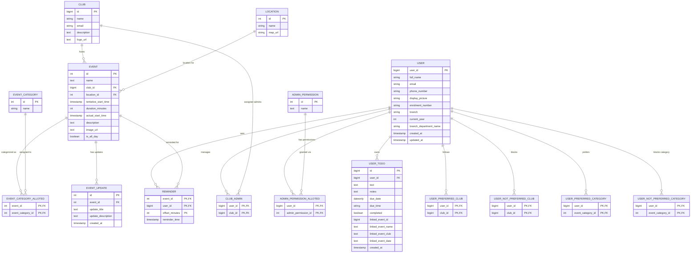

# Campus Dashboard & Event Planner — Architecture & Database Documentation

This directory contains technical documentation for the **IITR Campus Dashboard & Event Planner** backend and frontend system.

---

## 1. High-Level Architecture Overview

The system is structured as a full-stack campus event and personal management platform:
- **Frontend**: React Single Page Application (Vite, React Router, Lucide Icons, PWA enabled).
- **Backend**: Express.js REST API with Node.js.
- **ORM & Database**: Sequelize ORM connecting to PostgreSQL (Neon Cloud / Local).
- **Auth Flow**: Channel-i OAuth 2.0 authentication combined with HTTP-Only JWT cookies.

---

## 2. Entity-Relationship (ER) Diagram



---

## 3. Core Database Tables & Models

### 1. `user`
Stores student / user profile information synchronized directly from Channel-i OAuth.
* **Primary Key**: `user_id` (BIGINT, mapped from Channel-i `userId`).
* **Key Fields**: `email`, `enrolment_number`, `branch`, `current_year`, `display_picture`.

### 2. `club`
Campus clubs, groups, or administrative bodies hosting events.
* **Primary Key**: `id` (BIGINT).
* **Fields**: `name`, `email`, `description`, `logo_url`.

### 3. `event`
Events posted by campus clubs or populated via the Academic Calendar integration.
* **Primary Key**: `id` (INTEGER).
* **Foreign Keys**: `club_id` $\rightarrow$ `club(id)`, `location_id` $\rightarrow$ `location(id)`.
* **Fields**: `tentative_start_time` (TIMESTAMPTZ), `duration_minutes`, `is_all_day`, `image_url`.

### 4. `user_todo`
Personal Assistant & TODO items created by students or auto-linked directly from event cards.
* **Primary Key**: `id` (BIGINT).
* **Foreign Key**: `user_id` $\rightarrow$ `user(user_id)`.
* **Fields**: `text`, `notes`, `due_date`, `due_time`, `completed`, `linked_event_id`, `linked_event_name`.

### 5. `reminder`
Browser/local notifications scheduled by users for specific events with customized lead times.
* **Composite Primary Key**: `(event_id, user_id, offset_minutes)`.
* **Fields**: `reminder_time`.

### 6. `admin_permission` & `admin_permission_alloted`
Global administrative role management system (`event_crud`, `manage_admins`, etc.).

---

## 4. Initialization & Migration Workflow

Database schema creation, indexing, and constraint configuration are managed programmatically:
* **Entry point**: `temp_backend/database/initializeSchema.js`
* **Sequelize Auto-Sync**: Creates table definitions if non-existent without destroying production data.
* **Seed Data**: Automatically ensures default admin permissions (e.g. `event_crud`) exist on startup.

To force a fresh database setup locally:
```bash
cd temp_backend
node database/initializeSchema.js
```
